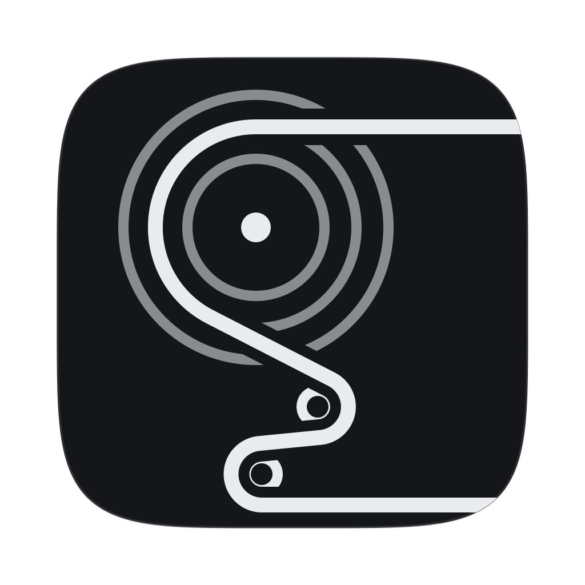
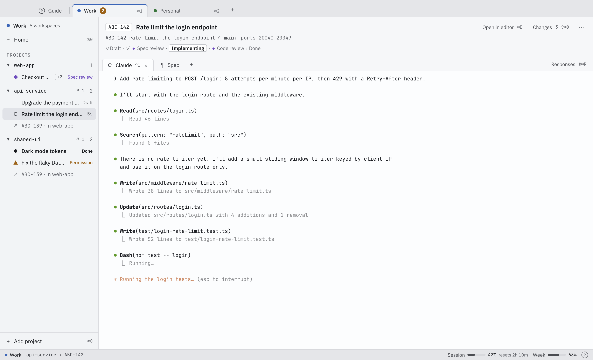
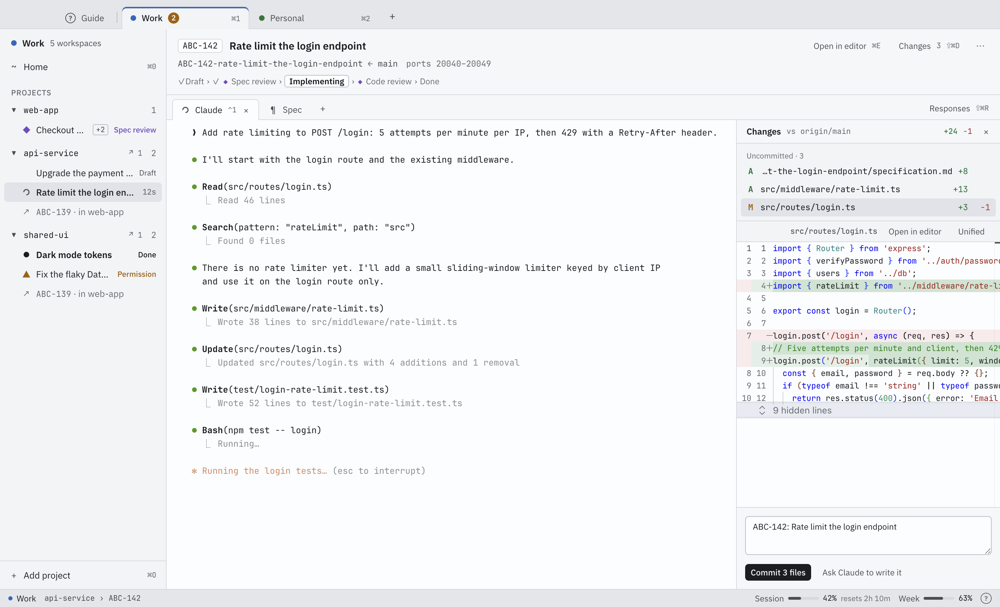
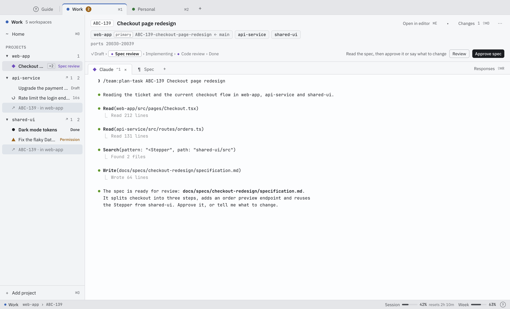
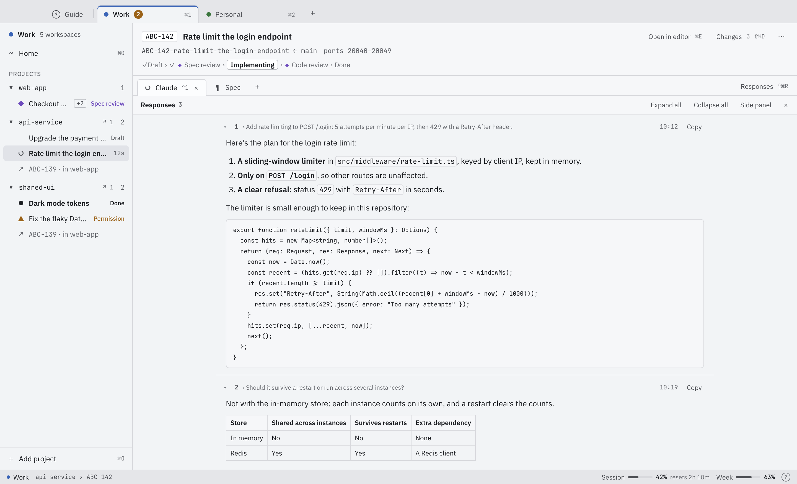

<p align="center">
  
</p>

<h1 align="center">Relur</h1>

<p align="center">
  Run many Claude Code sessions side by side, each in its own worktree, and know exactly when one needs you.
</p>

<p align="center">
  <a href="LICENSE"></a>
  <a href="https://github.com/dino-zecevic/relur/releases/latest"></a>
  
  <a href="https://code.claude.com"></a>
</p>

<p align="center">
  <b>Download:</b>
  macOS <a href="https://github.com/dino-zecevic/relur/releases/latest/download/Relur-mac-arm64.dmg">Apple Silicon</a> · <a href="https://github.com/dino-zecevic/relur/releases/latest/download/Relur-mac-x64.dmg">Intel</a>
  &nbsp;|&nbsp;
  Linux AppImage <a href="https://github.com/dino-zecevic/relur/releases/latest/download/Relur-linux-x64.AppImage">x64</a> · <a href="https://github.com/dino-zecevic/relur/releases/latest/download/Relur-linux-arm64.AppImage">arm64</a>
  &nbsp;|&nbsp;
  Linux .deb <a href="https://github.com/dino-zecevic/relur/releases/latest/download/Relur-linux-x64.deb">x64</a> · <a href="https://github.com/dino-zecevic/relur/releases/latest/download/Relur-linux-arm64.deb">arm64</a>
</p>

<p align="center">
  <a href="#install">Install</a> · <a href="#quick-start">Quick start</a> · <a href="#faq">FAQ</a> · <a href="docs/SPEC.md">Specification</a> · <a href="LICENSE">MIT license</a>
</p>

<picture>
  <source media="(prefers-color-scheme: dark)" srcset="docs/images/workspace-working-dark.png">
  
</picture>

## Highlights

- **Parallel sessions:** every task gets its own git worktree, branch and Claude Code session.
- **Status at a glance:** working, needs permission, waiting for input or done, in the sidebar, the Dock badge and notifications.
- **Profiles:** separate Claude accounts for work and personal projects, side by side.
- **Changes panel:** the diff against the base branch, then Commit, Push and Create PR.
- **Several repositories, one task:** a workspace can span repositories, with one Claude across all of them.
- **The real `claude`:** the official, unmodified Claude Code, in a terminal you can see; local only, no telemetry.

## What it does

### One task, one workspace

Each task gets its own git worktree and branch, its own Claude Code session, shells and ports, so several can run at once without stepping on each other. Setup commands and `.worktreeinclude` files prepare a new worktree; the **Changes** panel commits, pushes and opens a pull request; **Delete** removes the worktree. A workspace can also span several repositories, each in its own worktree on the same branch, with one Claude working across all of them.

### Know when Claude needs you

Every workspace shows whether Claude is working, needs permission, waits for input or is done: in the sidebar, the Dock badge, notifications and optional sounds. Background agents count as work, so **Done** means done. Plan usage sits in the status bar.

### Profiles keep accounts apart

A profile is one Claude account (its own Claude Code config folder) with its own projects, environment and settings, shown as a tab. Work and personal sessions never share a login.

### Review what changed

The **Changes** panel lists what the workspace changed against its base branch, with a diff for each file, and a commit message you write or ask Claude to write. Then **Commit**, **Push** and **Create PR**, one step at a time; a badge shows the pull request's state. **Open in editor** opens the worktree or one file in the editor you choose.

<picture>
  <source media="(prefers-color-scheme: dark)" srcset="docs/images/changes-diff-dark.png">
  
</picture>

### Your team's skills and workflow

Load skill sources (folders or git repositories) into Claude for a profile or for chosen projects. A workflow reads the task's status file and shows it as a stepper, with Continue and approval gates, and the task's specification as a tab of its own. Type only a task id in **New workspace**, and Claude (through your connectors) or a script of yours finds its title.

<picture>
  <source media="(prefers-color-scheme: dark)" srcset="docs/images/workflow-gate-dark.png">
  
</picture>

### Read Claude's answers

The **Responses** panel shows Claude's answers as readable blocks, with Markdown, code and tables, beside the terminal or full view. Copy one with a click.

<picture>
  <source media="(prefers-color-scheme: dark)" srcset="docs/images/responses-full-view-dark.png">
  
</picture>

The in-app **Guide** (⇧⌘/) explains every feature; [docs/SPEC.md](docs/SPEC.md) is the full specification.

## Requirements

- macOS 13 or later, on Apple Silicon or Intel.
- [Claude Code](https://code.claude.com). If it's missing, the app's setup check installs it with Claude Code's official installer, in a terminal you can see.
- A Claude plan (Pro, Max, Team or Enterprise).
- git.

## Install

### macOS

```sh
curl -fsSL https://raw.githubusercontent.com/dino-zecevic/relur/main/install.sh | sh
```

The script ([install.sh](install.sh), short enough to read first) picks your Mac's architecture, downloads the latest release, checks it against the release's `SHA256SUMS` and installs `Relur.app` into `/Applications` (or `~/Applications`), never with `sudo`. It also links the `relur` command line tool into `~/.local/bin`.

Or download `Relur-mac-arm64.dmg` (Apple Silicon) or `Relur-mac-x64.dmg` (Intel) from the [latest release](https://github.com/dino-zecevic/relur/releases/latest).

**Why macOS may ask once:** the app is signed ad hoc, not with an Apple Developer ID, so it isn't notarized. `curl` doesn't add the quarantine mark, so the install script's copy opens normally. A `.dmg` or `.zip` downloaded with a browser is refused the first time: open **System Settings › Privacy & Security** and click **Open Anyway**.

To update, run the install command again. To uninstall, add `-s -- --uninstall` after `sh`. Your settings stay in `~/Library/Application Support/Relur` until you delete them; Claude logins, repositories and worktrees are never touched.

### Linux (beta)

Linux builds are beta: they're tested in Docker but not yet on a real desktop. The same `curl` command installs the AppImage as `~/Applications/Relur.AppImage` and adds Relur to your desktop's app list. On Debian and Ubuntu you can install the release's `.deb` instead:

```sh
sudo apt install ./Relur-linux-x64.deb   # or Relur-linux-arm64.deb
```

Linux needs glibc 2.31 or later (Ubuntu 22.04, Debian 12, Fedora 36 and later), on Wayland or X11. The AppImage needs `fusermount` (`sudo apt install fuse3`); on Ubuntu 23.10 and later it also needs an AppArmor profile for Chromium's sandbox, which the install script prints the commands for (the `.deb` sets it up itself). Shortcuts use Ctrl for ⌘, and Ctrl+Shift where the shell uses that letter. The Guide's **Getting started › Relur on Linux** has the details.

## Quick start

1. **Install Relur and open it.** It starts with **Create your first profile**.
2. **Create a profile.** Give it a name and a color and pick its Claude account. The setup check makes sure git and Claude Code are ready; if the account isn't signed in yet, it shows Claude Code's own sign-in command and runs it in a terminal you can see.
3. **Add a project** (⌘O): a git repository, or a folder that holds several.
4. **Create a workspace** (⌘N): type the task, for example `ABC-142 Rate limit the login endpoint`. Relur creates the worktree and branch and starts Claude in it.
5. **Work with Claude**, and start another workspace while it runs. When one needs you, its status glyph changes and the profile tab gets a badge.

## Privacy

- Relur runs locally. Its own code makes no network requests other than to its local hook bridge on `127.0.0.1`; everything else goes through git, Claude Code or commands you set up.
- No telemetry, no analytics, no accounts.
- It stores no credentials and never touches your Claude login: profiles point Claude Code at its own config folders, and signing in is done with Claude Code's own commands.

## FAQ

**How is this different from running `claude` in a terminal?**
It *is* `claude` in a terminal, the official command, unmodified. Relur adds what's around it: a worktree and branch per task so sessions don't collide, a status for every session so you know which one needs you, separate accounts per profile, and a panel to review, commit and open a pull request.

**Does my code go anywhere?**
Not through Relur. It runs locally, with no telemetry, analytics or accounts; its own code only talks to its hook bridge on `127.0.0.1`. Your code reaches Anthropic the way it does whenever you use Claude Code, and your git host when you push. See [Privacy](#privacy).

**Does it work with my existing Claude Code setup, skills and connectors?**
Yes. A profile uses an existing Claude config folder (`~/.claude` or any other), with its login, settings, skills, plugins, MCP servers and claude.ai connectors. Relur adds its hooks and status line for the session through `--settings` and writes nothing into that folder or into your repositories.

**Linux? Windows?**
Linux is in beta: x64 and arm64, as an AppImage or a `.deb`, tested in Docker but not yet on a real desktop. Windows isn't supported yet.

**Is it made by Anthropic?**
No. Relur is an independent open-source project, not affiliated with or endorsed by Anthropic.

## Build from source

You need Node.js 22 and git (on Linux also `build-essential python3`). Clone the repository, run `npm ci`, then `npm run install-app` to build and install the app on this machine; [CONTRIBUTING.md](CONTRIBUTING.md) has the scripts, tests and packaging.

## Contributing

Issues and pull requests are welcome; read [CONTRIBUTING.md](CONTRIBUTING.md) first. Report security issues privately, as [SECURITY.md](SECURITY.md) describes. This project follows a [code of conduct](CODE_OF_CONDUCT.md).

## License

[MIT](LICENSE). Third-party licenses are in [THIRD_PARTY_NOTICES](THIRD_PARTY_NOTICES).

Relur is an independent project and is not affiliated with Anthropic. Claude and Claude Code are trademarks of Anthropic.
